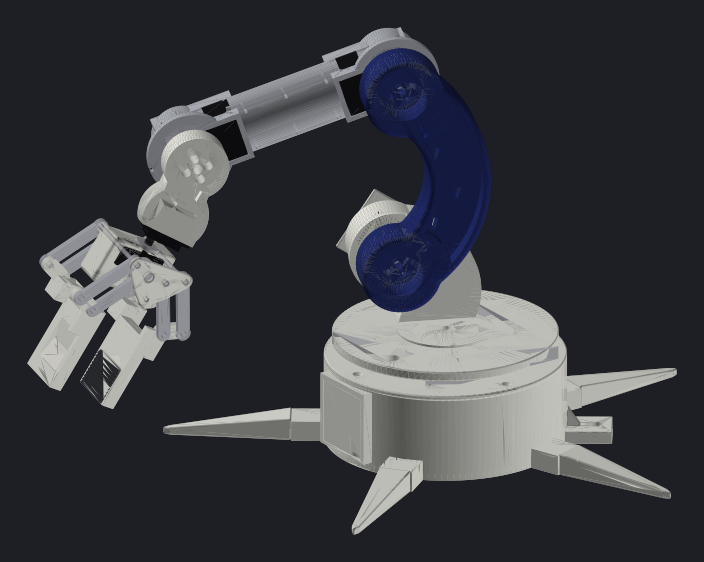
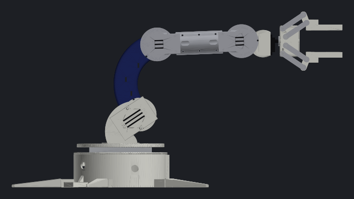
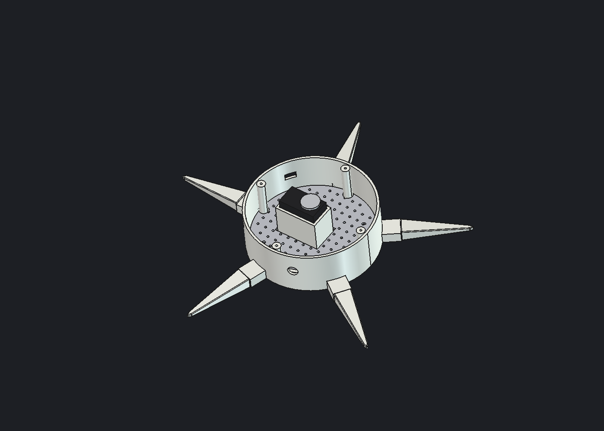
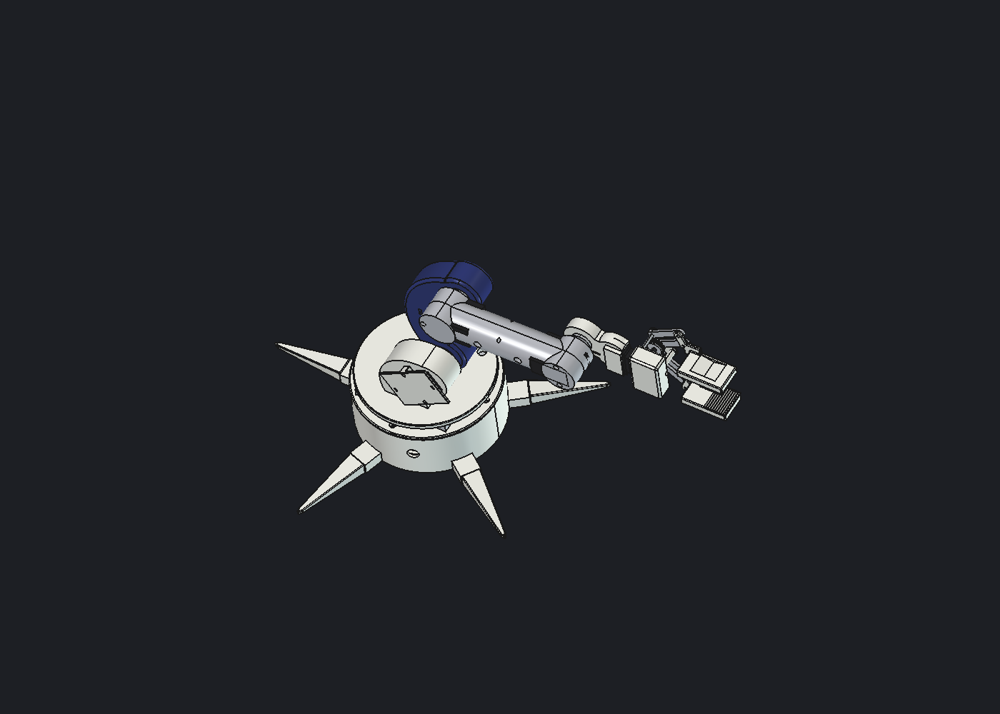
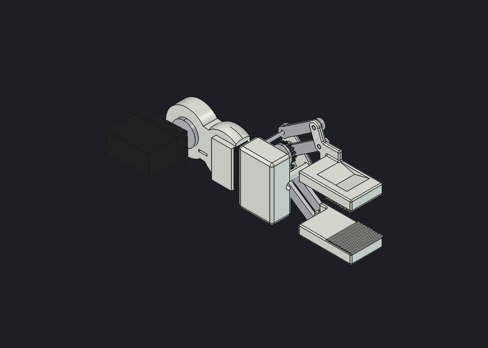

# Shell v1: เปลือกแขนทรง 4.1 บนจลนศาสตร์ spec v0

2026-10-28 · โรล C · ร่างรูปทรงสำหรับหน้าตาและการจัดวาง servo ยังไม่ได้ตรวจความแข็งแรง การพิมพ์ หรือจุดรองฝั่ง idle ของแต่ละข้อ

ที่มา: หน้าตาได้แรงบันดาลใจจาก FABRI CREATOR Brazo Robótico 4.1 (ดู [บันทึกถอดแบบ](../../docs/research/hardware-notes/2026-10-28-robotic-arm-4-1-teardown.md)) ตัวเลขทุกค่ามาจาก spec และ servo ของเรา ไม่ได้เปิดหรือวัดไฟล์ STL/STEP ของผู้ขาย ไม่ใช้โลโก้ผู้ขาย




## รัน (macOS / Windows / Linux)
ต้องมี FreeCAD 1.1 และ [uv](https://docs.astral.sh/uv/) (สำหรับภาพ render; uv ดึง numpy-stl/matplotlib เอง)

```
python run_shell_v1.py            # build + render ท่า zero/ready ลง renders/
python run_shell_v1.py --check    # + ตรวจ FK และการชน (~30 s)
python run_shell_v1.py --open     # + เปิดใน FreeCAD พร้อมสี
python run_shell_v1.py --poses '{"reach": {"shoulder_lift": 40, "elbow_flex": -30}}'
```
หา `freecadcmd` จาก PATH, `FREECADCMD`, `/Applications/FreeCAD.app/...` หรือ `C:\Program Files\FreeCAD*\bin\` อัตโนมัติ

## ไฟล์
- `shell_v1_model.py`: รูปทรงทุกชิ้น, พารามิเตอร์ (`P`, `STS`, `MG`), การจัดท่า (`posed`), export
- `build_shell_v1.py`: entry สำหรับ `freecadcmd` หรือ GUI → `shell_v1.FCStd`, `out/shell_v1.step`, STL รายชิ้นใน `out/` (out/ ไม่เข้า git, ~10 MB)
- `check_shell_v1.py`: ตรวจ FK กับ spec และการชนระหว่างชิ้นต่างลิงก์ขณะกวาดแต่ละข้อ
- `motion_moves.py` + `motion_test.py`: ทดสอบงานหยิบ–วาง–กดปุ่มเป็นรายมูฟบน CAD (ผลล่าสุดใน [บันทึกทดสอบ](../../docs/research/hardware-notes/2026-10-31-motion-test-results.md)) รันด้วย `freecadcmd motion_test.py`
- `workspace_sweep.py`: กวาดท่าที่ soft limit อนุญาต รวมข้อมือ ฐาน โต๊ะ และขาฐาน
- `cable_check.py`, `flex_check.py`: ความยาวสายผ่านข้อต่อ และการงอของลิงก์ด้วย FEM (gmsh + CalculiX)
- `render_shell_v1.py`: ภาพ render จาก STL (`uv run` ติดตั้ง dependency ให้เอง)
- `base_v1.py`: ถัง, ฝา, ถาดบอร์ด, ขา 5 ชิ้น, จานหมุนบน lazy susan (พร้อมพิมพ์)
- `links_v1.py`: เสา+จานหมุน, แผ่นยึด servo ไหล่, ลิงก์โค้ง, ท่อนแขนท่อกลมสองซีก (พร้อมพิมพ์)
- `wrist_gripper_v1.py`: ข้อมือ + ก้ามพร้อมพิมพ์ (ดูหัวข้อด้านล่าง); `out/print/` = STL ชิ้นพิมพ์
- `open_shell_v1.FCMacro`: เปิดไฟล์ใน FreeCAD ใส่สีและแสดงทุกชิ้น แล้วเซฟ (ไฟล์ที่ build แบบไม่มีจอ เปิดมาจะซ่อนทุกชิ้นและไม่มีสี)
- สร้างใน FreeCAD ที่เปิดอยู่ได้ตรงๆ: รัน `build_shell_v1.py` จาก Macro → Macros… จะได้สีทันที

## ออกแบบอย่างไร
- **แกนข้อต่อ:** อ่านจาก `arm_spec/small_arm_v0.json` ตรงๆ (ทาง A) FK ของจุดต่อ wrist_roll ตรงกับ spec 0.0000 mm ทั้ง 3 ท่าที่ตรวจ
- **วางเคียงแบบ 4.1:** เสาไหล่และท่อนแขนอยู่ด้านหลัง (y −42…−14) ลิงก์โค้งสีน้ำเงินอยู่หน้า (y −6.5…21.5) servo ไหล่อยู่ในเสา servo ศอกอยู่ในท่อนแขน เพลาชี้ +y ตัว servo โผล่ด้านหลัง 7 mm horn ทั้งสองยึดกับด้านหลังของลิงก์โค้ง ห่วงท่อทั้งสองข้างจึงเปิดโล่งด้านหน้า
- **ฐาน:** ถังปิด Ø120 สูง 56 + ขาใบแหลม 5 ขา รัศมี 160 mm + จานหมุน Ø96 + รูสายเยื้องแกน 24 mm (Ø14) + รูแจ็ก DC ด้านหลัง servo ฐาน STS3215 ตั้งในถัง
- **ข้อมือ:** STS3215 ก้ม-เงยอยู่ปลายท่อนแขน (D35, 2026-10-29: แทน MG996R เพื่ออ่านมุมกลับได้และช่วง ±95°); ตัวข้อมือหุ้ม STS3032 หมุน (D33)
- **ก้าม:** ออกแบบเอง สองนิ้วขนาน four-bar (ก้านยาว 40 mm) ขับด้วย STS3032 ตัวเดียวผ่านเฟืองคู่ซิงก์ ปลายนิ้วมีซี่ ในไฟล์ตั้งไว้ที่ 34° ช่องห่าง 34.7 mm
- **สี:** ตามโมเดล 3D ของผู้ทำในคลิป: น้ำเงินเฉพาะลิงก์โค้ง นอกนั้นขาว/เทาอ่อน; เก็บใน property `DisplayColor` ของแต่ละชิ้น

ค่าที่เป็น**ค่าประมาณ ต้องวัดของจริง**: ระยะเพลาเยื้องของ STS3215 (11.0 mm), ขนาด horn Ø22; STS3032 ใช้ขนาดรวม 23.2 × 12.1 × 28.5 mm จากหน้าร้าน (ไม่ใช่ datasheet Feetech) ส่วนการแบ่งตัวถัง/แกน ปีก ระยะเพลา และ horn Ø16 เป็นค่าเดาแบบ micro servo

## H1 แก้ข้อ 1–4 จากรีวิว (2026-10-29)
ดูเหตุผลใน [รีวิว H1](../../docs/research/hardware-notes/2026-10-29-h1-design-review.md)
1. **ลูกปืน 6806 (30×42×7) ซ่อนในห่วง:** ที่ไหล่และศอก วงนอกอัดในห่วงของลิงก์โค้ง (ห่วงขยาย Ø44 → Ø50) วงในสวมบนปลอก (collar) ที่ยื่นจากเสา/ท่อนแขนล้อมรอบ horn ส่วนแกนกลาง (spigot) ในปลอกยังรับสกรู horn; ข้อมือก้ม-เงยปิดไว้ (`BR["wrist_bearing"]`) เพราะโหลดเบาแต่ลูกปืน ~22 g ที่ปลายแขนเพิ่มแรงบิดไหล่ ~0.7 kg·cm — เปิดได้ถ้าด่านวัดพบว่าข้อมือโยก
2. **ครีบอัด (crush ribs):** 4 ครีบต่อช่อง STS3215 ในเสาและท่อนแขน อัดตัว servo 0.15 mm กันลื่นโดยไม่ต้องรู้ตำแหน่งรูสกรูของ servo (สกรูเข้าตัว servo เพิ่มได้หลังวัดของจริง)
3. **ลิงก์โค้งลดน้ำหนัก:** ร่องลึก 10 mm จากทั้งสองหน้า เหลือแผ่นกลาง 8 mm (หน้าตัดแบบ I) ร่องหน้าเห็นเป็นร่องยาวแบบ 4.1
4. **รูหมุดคาลิเบรตท่าศูนย์ Ø3.2:** ฐาน (ผ่านจานหมุน → ฝาถัง), ไหล่, ศอก, ข้อมือก้ม-เงย (ผ่านลิงก์/ข้อมือ → ปีก flange บนเสา/ท่อนแขน) ใช้หมุดเหล็ก Ø3 จากเส้นเดิม เสียบ ตั้ง offset แล้วถอดออก; ข้อมือหมุนกับก้ามไม่มีหมุด (ใช้ encoder + หุบจนแตะ)

แรงบิดไหล่ (ประมาณ, มวลชิ้นพิมพ์ 35–45% ของตัน, บล็อก 50 g): ท่าพร้อม 3.4–3.6, ก้มหยิบ 6.2–6.7, เหยียดสุด 8.5–9.2 kg·cm (STS3215 rated 10) → กันท่าเหยียดด้วย soft limit ใน spec v1

**MEASURE เพิ่ม:** ขนาด/น้ำหนัก/ราคา 6806, ระยะอัดของที่นั่งลูกปืนและปลอกกับเครื่องพิมพ์ของทีม (พิมพ์ชิ้นทดสอบก่อน)

## H1 แก้ข้อ 5–8 จากรีวิว (2026-10-30)
5. **หูแคลมป์ยึดโต๊ะ 2 จุด** ด้านหลังถัง (มุม 144°, 216°) มีครีบเสริมที่ไม่บังที่วางแหวน รู Ø6.6 ใส่สลัก M6 หรือปากแคลมป์ตัว G; **แผ่น fiducial** ด้านหน้าถัง หน้าเรียบ มีร่อง 40.4 × 40.4 ลึก 0.6 mm รับแผ่น marker 40 mm
6. **ก้านคู่หลังของก้าม:** crank และ follower ชุดที่สองอยู่หลังฝ่ามือ (ไม่ขับ ตามชุดหน้า) หมุนบนบอสที่ฝ่ามือ นิ้วจึงถูกจับสองด้าน บิดข้างยากขึ้น; หมุดก้านตามยาวทะลุฝ่ามือ; **แผ่นยาง TPU** ที่ปลายนิ้วเป็นชิ้นพิมพ์แยก (`gripper_pad_up/dn`, ฟันหวี/ฟันเลื่อยอยู่บนแผ่น) อัดลงร่องลึก 1.5 mm
7. **ช่องระบายอากาศ:** ร่อง 3 เส้นบนซีกหลังท่อนแขนเหนือ servo แต่ละตัว และบนแผ่นยึด servo ไหล่
8. **soft limit ใน spec:** `soft_limits` ใน `arm_spec/small_arm_v0.json` — ไหล่ ≥ −90°, ศอก ≤ 70°, **ไหล่ + ศอก ≤ 90°** (จากการกวาดท่าผสม: ท่าที่ท่อนแขน/ก้ามพับลงชนถังทุกท่ามีผลรวม ≥ 100°), TCP ห่างแกนฐาน (แกน shoulder_pan) ≤ 0.38 m; `arm_spec.soft_limit_problems(spec, q)` บอกว่าท่าไหนผิดกฎ ให้ adapter ใช้ก่อนส่งคำสั่ง; `check_shell_v1.py` กวาดท่าไหล่×ศอกทุก 10° ที่กฎอนุญาต (ข้อมือ 0, ฐาน 0) — ยังไม่ได้กวาดข้อมือ/ฐานร่วม

## ท่อนแขนแบบ C (2026-10-31, D38)
ท่อกลม Ø37 เล็กกว่าหน้าตัด STS3215 ตัว servo จึงทะลุผนังท่อ ท่อนแขนจึงมีกรอบ 3 mm รอบ servo แต่ละตัว ช่องเปิดด้านข้าง ครีบยึดย้ายพ้นช่อง สกรูเพิ่ม 4 ตัว และร่องระบายอากาศอยู่ที่ดุม `SHELL_FOREARM=tube` สร้างท่อเดิมเพื่อเทียบเท่านั้น ส่วน `check_shell_v1.py` ตรวจว่า servo ไม่โผล่ด้านข้างและครีบครบ

## ฐาน + ขา + เดินสาย (`base_v1.py`, 2026-10-29)
- **ถัง Ø150 (ตาม spec v0) สูง 53 + ฝา 3 mm:** ขยายจาก Ø120 เพื่อรับแป้นหมุน lazy susan 4" (100 mm) ใน BOM D28 ระหว่างฝาถังกับจานหมุน; servo ฐาน STS3215 ตั้งในแท่นรอง (cradle) ฝาถังมีช่องรับหัว servo, horn ฐานยึดกับเสาที่ยื่นลงจากใต้จานหมุน
- **ขา 5 ชิ้นแยก:** เสียบลิ้นเข้าช่องรอบถังจากด้านนอก ยึดด้วย M3 จากด้านบนขาละตัว ปลายขาที่รัศมี 170 mm


| ชิ้นพิมพ์ | ปริมาตร | ≤ g PLA (ตัน) |
|---|---:|---:|
| base_drum | 187.0 cm³ | 231.9 |
| base_lid | 47.6 | 59.0 |
| base_tray | 30.3 | 37.6 |
| base_leg_1…5 | 13.2 ×5 | 16.3 ×5 |
| **ทั้งแขน 22 ชิ้นพิมพ์** | | **≤ 1,073** (ตัน; infill ปกติจะใช้น้อยกว่านี้มาก ต้อง slice ดูจริง) |

- **ถาดบอร์ด:** แผ่นรูพรุน 10 mm (Ø2.6) ยึดเสา 4 ต้นในถัง ใช้สกรูเกลียวปล่อยหรือเคเบิลไทร์ยึดบอร์ดได้ทุกขนาด (bus adapter, Nano, PCA9685/buck) ส่วน PSU 12V และ E-stop อยู่นอกถัง

**เส้นทางสาย (ทุกเส้นเดินนอกแขนแบบ 4.1 รวบด้วยเคเบิลไทร์ 2.5 mm):**
1. ในถัง: บอร์ดบนถาด → สายรวมขึ้นทางร่องโค้ง 60° บนฝา
2. ผ่านฐานหมุน: ช่องว่างวงแหวนสูง 8 mm ระหว่างเสายื่นของจานหมุน (r 15) กับรูกลาง lazy susan (r 31) ให้สายพันรอบแกนได้ ±180° (D25 ไม่ใช้ slip ring); เผื่อสายในถังราวหนึ่งรอบ (~150 mm) → ขึ้นรูจานหมุน Ø14 ด้านหน้าเสา
3. เสา: ช่องรัดสายบนแผ่นยึด servo ไหล่ (สาย bus ไหล่→ศอก)
4. ลิงก์โค้ง: ช่องรัดสาย 3 จุดตามแนวโค้ง
5. ท่อนแขน: ช่องสาย Ø18 ข้างใน ทางเข้า/ออก Ø8 ด้านหลังสองจุด
6. ข้อมือ: ช่องรัดสายบนคอข้อมือ, สาย servo หมุนออกท้ายกรง; ก้าม: สาย servo ออกใต้ฝ่ามือ
7. ผนังถัง (ระหว่างขา): รูแจ็ก DC 5.5×2.1, ช่อง USB-C ของ bus adapter, รูร้อยสาย Ø12 สำหรับสาย PSU/E-stop + สะพานรัดสายด้านในกันดึง

**MEASURE:** ขนาด/รูยึดของ lazy susan ที่ซื้อจริง (ตอนนี้ 100×100×8, รูกลาง Ø62, รูแผ่นล่าง ±40, รูแผ่นบน r 44), ตำแหน่ง/ขนาดแจ็กและพอร์ตของบอร์ดจริง, วิธียึด STS3215 ฐานลงแท่นรอง (ตอนนี้แค่บังคับด้วยแท่นและฝา ยังไม่มีสกรู)

## เสา ลิงก์ ท่อนแขน พร้อมพิมพ์ (`links_v1.py`, 2026-10-29)


| ชิ้นพิมพ์ (`out/print/`) | ปริมาตร | ≤ g PLA (ตัน) | วางพิมพ์ (แนะนำ) |
|---|---:|---:|---|
| column (เสา + จานหมุน ชิ้นเดียว) | 124.3 cm³ | 154.1 | จานคว่ำบนฐาน เสาตั้งขึ้น |
| servo_clamp_shoulder | 7.4 | 9.2 | แผ่นราบบนฐาน |
| upper_link | 169.0 | 209.6 | หน้าหลัง (ฝั่ง horn) บนฐาน ห่วงเปิดขึ้น |
| forearm_front / forearm_back | 51.0 / 52.0 | 63.3 / 64.4 | หน้าตัดผ่าครึ่งบนฐาน |

- **เสา + จานหมุน:** horn ฐานขันขึ้นจากด้านล่างเข้าจาน (M3 ×4) รูยาว Ø6 ตามแกนฐานให้ไขสกรูเพลาได้ก่อนใส่ servo ไหล่; servo ไหล่ใส่จากด้านหลัง โผล่ 7 mm แผ่นยึดคร่อมแล้วขัน M3 ×2 เข้าเสา
- **ลิงก์โค้ง:** horn ไหล่และศอกยึดที่หน้าหลัง สกรู M3 ×4 ต่อ horn ใส่จากในห่วง (หัวสกรูจมในห่วง) + รูกลางเข้าถึงสกรูเพลา; ร่องรัดสายกลางลิงก์ (สายเดินนอกแบบ 4.1)
- **ท่อนแขน:** ท่อกลม Ø37 แบบ 4.1 ผ่าครึ่งตามยาว ประกบหนีบ STS3215 ศอก + STS3215 ข้อมือก้ม-เงย ขัน M3 ×5 จากซีกหลัง (มี counterbore); ช่องสาย Ø18 ข้างใน รูออกสาย Ø8 ด้านหลัง 2 จุด
- ข้อต่อทุกข้อยังยึด horn **ด้านเดียว** (แบบ 4.1) ยังไม่มีลูกปืนฝั่งตรงข้าม ต้องดูอาการโยกหลังประกอบ
- รวมชิ้นพิมพ์ทั้งหมด (ยกเว้นฐาน) ≤ 610 g ถ้าพิมพ์ตัน; ลิงก์โค้งหนักสุด ถ้าพิมพ์ infill 20–30% จะเบาลงมาก แต่ยังไม่ได้คำนวณ torque ไหล่ใหม่ด้วยมวลจริง

**MEASURE:** รูปแบบรู horn STS3215 (ตอนนี้สมมติ 4 รู r 7 M3), ระยะเผื่อ servo ในท่อ (0.3 mm)
**ยังไม่ได้ทำ:** ฐาน/ขาให้พร้อมพิมพ์, ทดลองพิมพ์, ความแข็งแรง/การโก่ง

## ข้อมือ + ก้าม พร้อมพิมพ์ (`wrist_gripper_v1.py`, 2026-10-29)
แบบ B ที่ผู้ใช้เลือก เริ่มจากส่วนที่เสี่ยงสุด กลไกตามภาพแยกชิ้นของ 4.1 (เฟืองคู่ขบกัน, นิ้วละสองก้าน, แผ่นครอบบน, นิ้วแผ่นยาว) ขนาดทั้งหมดเป็นของเรา



| ชิ้นพิมพ์ (`out/print/`) | ปริมาตร | ≤ g PLA (ตัน) |
|---|---:|---:|
| wrist | 28.1 cm³ | 34.8 |
| gripper_palm | 23.7 | 29.4 |
| gripper_gear_crank_up / _dn | 1.6 / 1.8 | 2.0 / 2.2 |
| gripper_follower_up / _dn | 1.1 / 1.1 | 1.4 / 1.4 |
| gripper_finger_up / _dn | 14.3 / 14.3 | 17.7 / 17.7 |
| gripper_cover | 2.2 | 2.8 |
| **รวม** | | **≤ 109** |

- **ช่อง servo:** ขนาดเผื่อให้ใส่ได้ทั้ง STS3032 และ MG90S (ตัดสินงบ D24 ทีหลังได้โดยไม่ต้องแก้ชิ้นพิมพ์) ใส่จากด้านหน้า ปีกวางบนผิว ขันสกรู M2 สองตัวต่อ servo
- **ข้อมือ:** ยึดกับ horn ของ STS3215 ข้อมือก้ม-เงยด้วย M3 ×4 ผ่าน hub (มี counterbore) + รูกลางเข้าถึงสกรูเพลา; สาย servo ออกท้ายกรง
- **ก้าม:** ยึดกับ horn ข้อมือหมุน 4 จุด + รูยาวเข้าถึงสกรูเพลา; เฟือง module 1, 14 ฟัน (ระยะแกน 14 mm) ตัวบนยึด horn ด้วย M2 ×2, ตัวล่างหมุนบนหมุด; ก้านยาว 40 mm; หมุดก้านตามเยื้อง (−5, ±13) mm จากแกนเฟืองให้ก้านสองเส้นห่างกัน ≥ 10 mm; แผ่นครอบยึดเสากลาง M2 + หมุดสองตัว
- **ฮาร์ดแวร์:** หมุดเหล็ก Ø3 (ตัดจากเพลา SUS304 ใน BOM D28): 32.6 mm ×2, 10.0 mm ×1, 6.8 mm ×4 · สกรู M2 เกลียวปล่อย: servo 4, ข้อมือ 4, ก้าม 4 + เฟือง 2 + ครอบ 1 · รูหมุด: อัดแน่น Ø2.9 ในฝ่ามือ/ครอบ, หมุนได้ Ø3.3 ในก้าน/นิ้ว/เฟืองล่าง
- **ช่วงก้าม:** crank 8.9° (หุบ ฟันแตะกัน) ถึง 64° (อ้า 59.5 mm); บล็อก 40 mm ที่ crank ≈ 41° → servo ใช้ราว 55° ของช่วง
- **ตรวจกลไก (`check_shell_v1.py`):** กวาด crank ทุก 5° จากหุบถึง 60° ไม่มีชิ้นในก้ามซ้อนกันเกิน 1 mm³ รวมฟันเฟือง

**ต้องวัดของจริงก่อนพิมพ์ (MEASURE ในโค้ด):** ความสูงปีก/ระยะรูปีก/ระยะเพลาของ STS3032 และ MG90S, รูปแบบรูของ horn ทุกตัว (STS3215 ×4, micro horn ข้อมือหมุนและก้าม), ระยะเผื่อรูหมุดกับเครื่องพิมพ์ของทีม
**ยังไม่ได้ทำ:** ทดลองพิมพ์, ทิศวางพิมพ์และ support (ส่งออกในทิศประกอบ), ความแข็งแรงของนิ้วที่ยึดก้านด้านเดียว, แรงหนีบจริง, TCP ใหม่ (กลางแผ่นนิ้ว ยังไม่ใส่ใน spec)

## ผลตรวจ (`check_shell_v1.py`, ทุก 10° ทีละข้อจากท่าศูนย์ + 2 ท่าผสม, ชน = common > 1 mm³)
| ข้อ | ผล |
|---|---|
| shoulder_pan −180/−90/90/180 | ไม่ชน |
| shoulder_lift −100…100 | ชนที่ **−100°** (ลิงก์โค้งลงไปโดนจานหมุน/เสา) ผ่าน −90…100 |
| elbow_flex −96.8…96.8 | ชนที่ **80° ขึ้นไป** (ข้อมือ/ก้ามพับลงโดนถังฐาน Ø150 ตอนไหล่ 0°) |
| wrist_flex ±95 (STS3215), wrist_roll −157…163 (STS3032) | ไม่ชน |
| ท่าผสม 2 ท่า | ไม่ชน |

ยังไม่ได้ค้นทั้ง workspace; elbow ≥80° ชนเพราะแขนพับเข้าหาฐาน เป็นข้อจำกัดขึ้นกับท่า ต้องให้ตัวควบคุมกันไว้ ไม่ใช่แก้รูปทรง

## ต่างจาก spec v0 (ต้องตัดสินก่อนทำ spec v1)
1. **TCP:** ก้ามสมมาตร TCP จึงอยู่บนแกน wrist_roll ที่ (391.4, −0.2, 234.4) mm ท่าศูนย์ spec v0 อยู่ที่ (391.4, 0.0, 226.5) ต่างกัน ~8 mm และข้อ `gripper` ของ spec (ก้ามนิ้วเดียวของ SO-101) ไม่ตรงกับก้ามนี้
2. **shoulder_lift:** ใช้ได้ −90…100° ไม่ใช่ −100…100°
3. **ฐาน:** spec v0 เขียน Ø150 × 35 (concept) เปลือกนี้ใช้ถัง Ø120 × 56 + ขา; ความสูงแกน pan เท่าเดิม (62.4 mm จาก base_link)
4. **มวล:** ยังไม่ได้คำนวณใหม่ ปริมาตรชิ้นพิมพ์ดูจาก output ของ build

## ยังไม่ได้ทำ
ฝั่ง idle ของแต่ละข้อ (เพลา/ลูกปืน), ความแข็งแรงและ torque ด้วยมวลใหม่, แบ่งชิ้นสำหรับพิมพ์, ช่องสกรู/ร่องสาย, slip ring หรือวิธีกันสายพันตอนหมุน 360°, horn spline จริง
