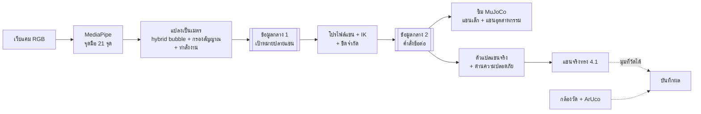
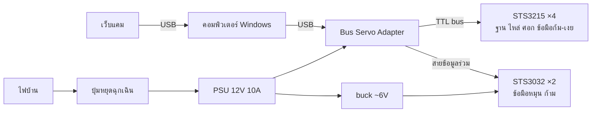

# การพัฒนาระบบควบคุมแขนกลผ่านกล้อง
**Development of a Camera-Based Robotic Arm Control System**

รุ่น 3.2 · 2026-10-31 · ฐานเนื้อหาสำหรับสไลด์เสนออาจารย์ (B นำ ทั้งทีมคิดร่วม) · เนื้อหาในไฟล์นี้ตัดสินแล้วโดยโรล C (D01, D27, D31, D33–D35) ผู้ทำสไลด์จัดรูปแบบได้ แต่ถ้าจะเปลี่ยนเนื้อหาให้คุยกับ C ก่อน

## 1. หัวข้อ
- ไทย: การพัฒนาระบบควบคุมแขนกลผ่านกล้อง
- อังกฤษ: Development of a Camera-Based Robotic Arm Control System

## 2. ที่มาและความสำคัญ
การควบคุมแขนกลด้วยจอยสติ๊ก ถุงมือเซนเซอร์ หรือแขนต้นแบบ มีข้อแลกเปลี่ยนด้านอุปกรณ์และการติดตั้ง โครงการนี้ใช้กล้องเว็บแคมติดตามมือ ผู้ใช้จึงควบคุมหุ่นยนต์ได้โดยไม่ต้องถือหรือสวมอุปกรณ์

ความท้าทายหลักคือมือคนกับแขนกลมีสเกลไม่เท่ากัน มือขยับได้สบายในกรอบไม่กี่สิบเซนติเมตร แต่แขนกลแต่ละรุ่นมีพื้นที่ทำงานต่างกัน ระบบต้องแปลงการเคลื่อนไหวให้ไปตามสัดส่วน คุมได้ละเอียดตอนเข้าเป้า เคลื่อนที่ได้ไกลเมื่อต้องการ และสั่งงานได้ง่าย

## 3. วัตถุประสงค์
1. พัฒนาระบบควบคุมแขนกลด้วยการติดตามตำแหน่งมือ การหมุนข้อมือ และท่านิ้วผ่านกล้อง RGB ตัวเดียว โดยหมุนเฉพาะแกนที่แขนแต่ละรุ่นทำได้
2. พัฒนาระบบแปลงสเกลการเคลื่อนไหวจากมือไปยังแขนกลต่างขนาด โดยใช้ส่วนประมวลผลมือและรูปแบบข้อมูลกลางร่วมกัน
3. ประเมินความแม่นยำและความง่ายในการสั่งงานของวิธีแปลงสเกล โดยเทียบการ mapping แบบ relative กับแบบ hybrid bubble

## 4. ขอบเขตและแนวทางดำเนินงาน
- กล้อง RGB หนึ่งตัว ผู้ใช้หนึ่งคน มือเดียว แสงและตำแหน่งกล้องคงที่ ปรับเทียบก่อนใช้งานได้
- ตำแหน่งมือถูกแปลงเป็นหน่วยเมตร แล้วใช้ hybrid bubble: ในฟองคุมตำแหน่งแบบละเอียด นอกฟองแขนเลื่อนต่อตามทิศ สเกลปรับตามพื้นที่ทำงานของแขนแต่ละรุ่น
- การหมุนข้อมือใช้แนวคิด bubble เดียวกัน: บิดนิดเดียวแขนหมุนตามมุม บิดเกินช่วงแขนหมุนต่อเนื่องจนกว่ามือกลับกลาง
- ท่านิ้วใช้สั่งก้ามหนีบและโหมด (ตาม/พัก/ละเอียด) และมีปุ่มหยุดฉุกเฉินจริง
- ทดสอบกับแขนสองขนาด: แขนจริงขนาดเล็ก (ของจริงและในซิม) และแขนอุตสาหกรรมในซิม (B เลือกรุ่น) ระยะที่สอง ถ้าทันตามจุดตัดสินกลาง ก.พ. เพิ่มมือหลายนิ้วในซิมที่คุมทีละนิ้ว
- งานทดสอบ: เคลื่อนตามเป้าหมาย, หยิบบล็อก 4–5 ซม. วางในถาด, กดปุ่ม ~3 ซม.

### แขนจริง
- CAD ของทีมเอง ทรง FABRI Brazo Robótico 4.1 (วาดเองจากภาพสาธารณะ ไม่ใช้ไฟล์ผู้ขาย) บนจลนศาสตร์ SO-101 แบบเปิด (Apache-2.0) 5 แกน + ก้ามหนีบ ประกอบเอง พิมพ์ 3D บนฐานกลมที่ทีมออกแบบ หมุนฐานได้รอบวง (±180°) ระยะเอื้อมคำนวณ ≈ 42 ซม. จากแกนไหล่ (ยังไม่วัดจริง) เก็บชิ้น SO-101 เป็นแผนสำรอง
- มอเตอร์: bus servo อ่านมุมกลับได้ทั้ง 6 ข้อ ได้แก่ Feetech STS3215 12V ×4 ที่ฐาน ไหล่ ศอก ข้อมือก้ม-เงย (ตั้งความเร็ว/ความเร่งในตัวมอเตอร์ได้) + STS3032 6V ×2 ที่ข้อมือหมุนและก้าม
- งบไม่เกิน 5,800 บาทต่อแขนก่อนอากร; BOM ประเมิน ~5,776 บาท รวมมอเตอร์ บอร์ด ไฟเลี้ยง ปุ่มหยุดฉุกเฉิน อุปกรณ์ และค่าส่งในไทย ยังไม่รวมอากรนำเข้าและลูกปืนในข้อต่อตามข้อเสนอ H1 (รายละเอียดใน P005)
- ภาพ 3D และวิดีโอ: ภาพ CAD ของแขนปัจจุบันและโมเดลนำเสนอรุ่นก่อนหน้า (ดูข้อ 10)
- หมายเหตุสำหรับผู้ทำสไลด์: นำเสนองบเป็นข้อจำกัดของโครงการ ไม่ใช่จุดขายเรื่องความประหยัด (D06)

## 5. เครื่องมือที่ใช้ทั้งโครงการ
สถานะ: ✅ ใช้แน่นอน · 🔄 กำลังทดสอบ/กำลังเลือก (ขึ้นสไลด์ได้โดยเขียนสถานะกำกับ)

**ฮาร์ดแวร์**
| เครื่องมือ | ใช้ทำอะไร | สถานะ |
|---|---|---|
| เว็บแคม RGB ทั่วไป 1 ตัว | อ่านมือผู้ใช้ | ✅ |
| คอมพิวเตอร์ Windows (ASUS) และ MacBook M1 | รันระบบและซิม (ASUS) · พัฒนาโค้ด (M1) | ✅ |
| เครื่องพิมพ์ 3D (bed ≥ 220×220 มม.) | พิมพ์ชิ้นแขนและฐาน | ✅ |
| แขนจริง: STS3215 12V ×4, STS3032 6V ×2 | ขับข้อต่อ | ✅ |
| Waveshare Bus Servo Adapter (A) | สั่งและอ่านมุม bus servo จากคอมพิวเตอร์ | ✅ |
| PSU 12V 10A + buck ลงราว 6V, ฟิวส์, ปุ่มหยุดฉุกเฉิน | จ่ายไฟและตัดไฟฉุกเฉิน | ✅ |
| ArUco marker + กล้องวัด | วัดตำแหน่งปลายแขนจริงจากภายนอก | ✅ |

**ซอฟต์แวร์**
| เครื่องมือ | ใช้ทำอะไร | สถานะ |
|---|---|---|
| Python | ภาษาหลักของทุกส่วน | ✅ |
| MediaPipe | ตรวจจับจุดมือ 21 จุดจากภาพกล้อง (โมเดลสำเร็จรูป) ส่วนการแปลงการเคลื่อนไหวเป็นวิธีคำนวณ | ✅ |
| OpenCV + NumPy | อ่านภาพ ปรับเทียบกล้อง อ่าน ArUco คำนวณ | ✅ |
| MuJoCo | ซิมแขนสองขนาดและการสัมผัสวัตถุ | 🔄 ทดสอบบน Windows (P001) |
| ไลบรารี IK | แปลงเป้าหมายปลายแขนเป็นมุมข้อต่อ | 🔄 B เลือก |
| ไลบรารีคุม bus servo (Feetech/Waveshare) | สั่งและอ่านมุม STS3215 และ STS3032 | 🔄 C เลือก |
| dex-retargeting | แปลงท่านิ้วไปมือหลายนิ้ว (ระยะที่สอง) | 🔄 ถ้าทัน |
| FreeCAD + slicer ของเครื่องพิมพ์ | ออกแบบตัวแขน ฐาน และที่ยึดมอเตอร์ เตรียมไฟล์พิมพ์ | ✅ |
| Git, GitHub, GitHub Actions | เก็บโค้ด ทำงานร่วมกัน ทดสอบอัตโนมัติ | ✅ |

ไม่ใส่ในสไลด์: โค้ดทดลอง TensorFlow keypoint classifier (พักไว้ ไม่อยู่ในระบบหลัก, D31)

## 6. แบบจำลองระบบ (block diagram)
ผู้ทำสไลด์วาดใหม่ได้ แต่ลำดับกล่องและชื่อต้องคงตามนี้

**การไหลของข้อมูล**

**การต่อฮาร์ดแวร์แขนจริง**

วิธีแยกไฟ 6V ของ STS3032 ยังไม่ล็อก ผังนี้เป็นแนวทางที่ตรงกับงบ ~5,776 บาท (D33, D35)

หยุดสองชั้น (D30): คำสั่งพักหรือมือหาย = แขนค้างท่า; ปุ่มหยุดฉุกเฉิน = ตัดไฟมอเตอร์

## 7. การประเมินผล
วัดความแม่นยำแยก 4 ชั้น ได้แก่ ความซ้ำได้ของแขนเอง, ความนิ่งของเป้าหมายจากกล้อง, ความคลาดเคลื่อนปลายแขนทั้งระบบ และอัตราสำเร็จของงาน พร้อมเวลาทำงาน ความต่อเนื่อง ความหน่วง และ Fitts' law throughput เทียบ mapping สองแบบภายใต้เงื่อนไขเดียวกัน รายงานผลในซิมและบนแขนจริงแยกกัน เกณฑ์ผ่านเชิงตัวเลขจะตั้งหลังรอบ pilot (มี.ค.) จากข้อมูลจริง

## 8. ผลที่คาดว่าจะได้รับ
ระบบต้นแบบที่ใช้มือเดิมคุมแขนกลต่างขนาดได้ผ่านกล้อง พร้อมผลทดลองที่แสดงว่าวิธีแปลงสเกลช่วยเรื่องความแม่นยำและความง่ายได้แค่ไหน และข้อจำกัดที่พบ

## 9. ระยะเวลาในการดำเนินงาน (ต.ค. 2569 – เม.ย. 2570)
✓ เสร็จแล้ว · ● กำลังทำ (ณ 23 ต.ค. 2569) · ○ ตามแผน · ★ จุดส่งงาน

| การดำเนินงาน | ต.ค. | พ.ย. | ธ.ค. | ม.ค. | ก.พ. | มี.ค. | เม.ย. |
|---|:-:|:-:|:-:|:-:|:-:|:-:|:-:|
| ปรึกษาอาจารย์ กำหนดขอบเขต และเสนอหัวข้อ | ● | ○ | | | | | |
| ออกแบบระบบ รูปแบบข้อมูลกลาง และเลือก/สั่งซื้อแขนจริง | ● | ○ | | | | | |
| พัฒนาระบบกล้องและการแปลงการเคลื่อนไหว | | ○ | ○ | ○ | | | |
| สร้างซิมแขนสองขนาด | | ○ | ○ | ○ | | | |
| ประกอบแขนจริงและระบบควบคุมมอเตอร์ | | | ○ | ○ | | | |
| รวมระบบ ทดสอบหยิบ–วางและกดปุ่ม ส่งความคืบหน้า | | | ○ | ★ | | | |
| มือหลายนิ้วในซิม (ระยะที่สอง ถ้าทัน) | | | | | ○ | | |
| วัดผลด้วยกล้องวัด ทดลองนำร่อง และล็อกวิธีทดลอง | | | | | ○ | ○ | |
| เก็บผลหลัก วิเคราะห์ ทำรายงานและส่งงาน | | | | | | | ★ |

จุดส่งงาน: ส่งความคืบหน้า ม.ค. 2570 (หยิบ–วางในซิมทั้งสองแขนด้วยมือจริง แขนจริงขยับได้ ตัวเลขชุดแรก) · ส่งงานทั้งหมดปลาย เม.ย. 2570 ไม่มีเวลาสำรองหลังจากนั้น ถ้างานช้าตัดจากท้าย: มือหลายนิ้วหยิบบล็อก → มือหลายนิ้วทั้งหมด → โหมด Z แยก (ตาม docs/roadmap.md)

## 10. สื่อประกอบสไลด์
- **ภาพแขนปัจจุบัน:** render ของ shell v1 ใน `cad/shell_v1/renders/` เป็น CAD ยังไม่ได้พิมพ์หรือประกอบจริง (D34)
- **โมเดลนำเสนอแขนทีม v0** (D32): https://claude.ai/artifact/16cAU9C8iB8u6YXwvE58Zd ทำก่อน D33–D35 จึงไม่ตรงแขนปัจจุบัน แสดงแขน SO-101 5 แกน + ก้ามบนฐานกลม มอเตอร์สีส้ม = STS3215 สีม่วง = MG996R สีชมพู = ชิ้นที่ทีมออกแบบหรือแก้ (ฐานกลม ชิ้นข้อมือและก้ามที่เจาะให้ MG996R) ตัวเลขทั้งหมดอ่านจากสเปกแขนจริง v0 ณ วันทำโมเดล
- **วิดีโอ:** กด "โหมดอัดจอ" แล้วอัดหน้าจอ (Windows: Win+Alt+R หรือ Snipping Tool, macOS: Cmd+Shift+5)
  - ฉาก "หยิบบล็อก → ถาด → กดปุ่ม" ยาว 10.9 s เหมาะกับสไลด์แขนจริงหรือขอบเขตงานทดสอบ
  - ฉาก "ช่วงหมุนแต่ละข้อ" ยาว 23 s เหมาะกับสไลด์แขนจริง
  - เลือกมุมกล้องก่อนกด (มุมหลัก/ด้านข้าง/มุมบน) ลากหมุนมุมได้
- **ภาพนิ่ง:** หยุดเล่นที่จังหวะที่ต้องการแล้วจับภาพหน้าจอ
- **คำบรรยายภาพที่ใช้ได้:** "โมเดลนำเสนอแบบร่างก่อนเปลี่ยนตัวแขนและมอเตอร์ ความเร็วตามเพดานมอเตอร์ ท่าตรวจล่วงหน้าว่าไม่ชน"
- **ห้าม:** เรียกว่าผลการทดลองหรือผลจากระบบควบคุมด้วยกล้อง ในวิดีโอไม่ต้องติดป้าย แต่คำพูดและข้อความบนสไลด์ต้องไม่บอกว่าเป็นผลระบบ (D32)
- รายละเอียดวิธีทำและผลตรวจ: docs/research/hardware-notes/2026-10-23-presentation-model-v0.md
